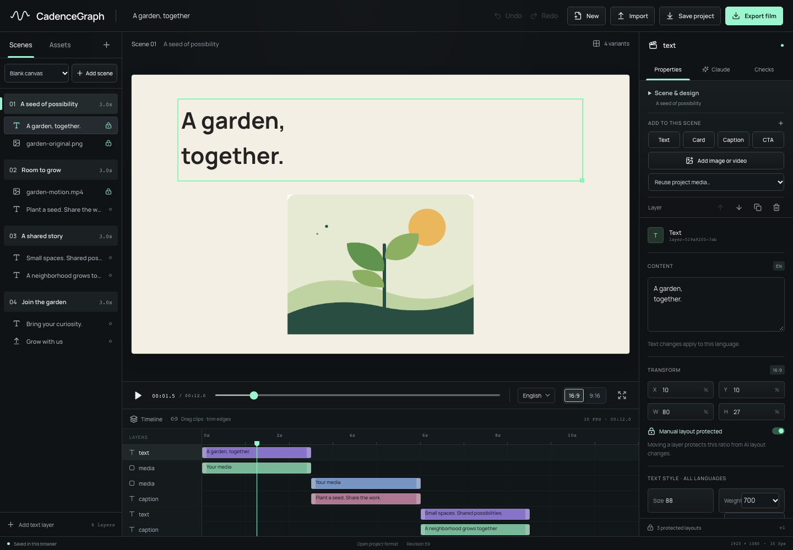

<div align="center">

# CadenceGraph

**Ideas move. Your design decisions stay.**

An open motion studio for building original scene sequences with people and Claude.

[Get started](#run-locally) · [Watch the films](#real-rendered-demos) · [Project format](docs/project-format.md) · [Build a component](docs/components.md) · [Contribute](CONTRIBUTING.md)

</div>



Start a blank project. Add your scenes, text and media. Shape their timing and motion, then export in two languages and two ratios. Ask Claude to propose a new scene or a revision; inspect the operations before applying them. Sentence timing stays connected, and your protected layout stays where you put it.

**Motion-video authoring alpha — v0.1.0-alpha.5.** A local scene editor and deterministic export pipeline for a deliberately bounded project format. See the [authoring acceptance record](docs/verification/authoring-acceptance.json) for the recorded checks and limitations; the [competitive review](docs/competitive-landscape.md) explains the scope.

## Run locally

Requirements: Node.js **22.12+** (22 or 24 LTS recommended), npm, and FFmpeg with `ffprobe` and `libx264` on PATH. macOS and Ubuntu are the verification targets. Chrome login is not required.

```sh
git clone https://github.com/webizmo/cadencegraph.git
cd cadencegraph
npm ci
npx playwright install chromium
# macOS, if FFmpeg is missing: brew install ffmpeg
# Ubuntu: sudo apt-get install ffmpeg
npm run dev
```

Open **http://127.0.0.1:5173**. The original three-scene example works without an AI account or network media. `npm run build && npm start` serves the production build locally. The server intentionally binds to loopback; it is not a multi-user service.

## Make your own film

1. Create a **New project** and name it. It starts with one empty four-second scene. Add a blank scene or an editable **Title**, **Quote**, **Three points**, or **Closing** design; change the sequence with scene duplicate, delete and move controls.
2. Add text, cards, captions, a CTA, or your own image/video. Reuse imported project media. Select a layer to change its copy, font size, weight, alignment, color and layout; duplicate, remove or reorder layers as needed.
3. Choose a project design (**Midnight**, **Paper**, or **Cobalt**) and optionally invert individual scenes. Select **9:16**, drag a layer or edit its X/Y fields, and keep that ratio-specific position protected.
4. Set the sentence duration, layer start/end offsets, entrance and delay. Drag/trim layer bars on the timeline or use the inspector. An empty end offset follows the sentence; fixed offsets must fit every language. Switch to **Türkçe** to author its text and duration separately. Attaching sentence audio measures and retimes that language; detaching it keeps the current duration.
5. Open **Claude** to propose a scene sequence, content revision, styling, motion or timing change. Review the actual operations and affected outputs. A proposal changes the project only after **Apply proposal**; protected-layout and stale-revision conflicts block the whole transaction.
6. Review all four variants, use **Undo / Redo**, and save/reopen project JSON. Open **Checks**, repair errors, then **Export film** to a real H.264/AAC MP4. Chromium checks text, bounds, fonts and media before encoding.

`Space` plays/pauses. `Cmd/Ctrl+Z` undoes; `Cmd/Ctrl+Shift+Z` redoes. Work is saved in browser local storage. Export project JSON for a durable copy. Uploaded media lives in `public/assets/uploads/`; copy those files alongside the project when moving machines. JSON export is not a media archive.

## Claude integration

Install [Claude Code](https://code.claude.com/docs/en/overview) and sign in using `claude auth login`. CadenceGraph invokes the installed CLI with your existing subscription or configured credentials. It does not bundle Claude Code, store keys in the project, or silently simulate Claude. Provider requests consume your account's allowance.

The local server sends the project JSON and your instruction to Claude. Tools, MCP servers, hooks and session persistence are disabled for this call; the model returns schema-constrained operations. Proposals can add, remove and reorder scenes, add/remove layers, and revise supported text, layout, style, motion and timing. Media must already exist in the project; Claude does not generate images, video, speech or transcription. Core validation is repeated before preview and application. Only clicking **Apply proposal** changes the editor project. No arbitrary model-generated code is executed.

The [alpha.4 live-provider record](docs/verification/claude-live.json) is historical evidence for the original integration. The [alpha.5 live call](docs/verification/authoring-ai.json) created a new bilingual scene while preserving the existing protected scene. Browser and render evidence is recorded in [authoring acceptance](docs/verification/authoring-acceptance.json). Automated provider fixtures are labeled separately from real authenticated calls; a fixture does not establish live Claude behavior.

## Real rendered demos

The [alpha.5 release](https://github.com/webizmo/cadencegraph/releases/tag/v0.1.0-alpha.5) accompanies the original authoring example, [Community Garden](examples/community-garden.cadence.json), and its [acceptance record](docs/verification/authoring-acceptance.json). Use the record and release assets to inspect what was actually rendered and checked.

The historical [alpha.4 release](https://github.com/webizmo/cadencegraph/releases/tag/v0.1.0-alpha.4) contains four base films and four after its five-revision scenario, with posters and reports. Those eight files prove the earlier revision workflow; they are not evidence of alpha.5 scene authoring. The original starter remains available:

| Variant | Frame size | Frame rate | Source |
| --- | --- | --- | --- |
| English · landscape | 1280 × 720 | 24 fps | [demo.json](examples/demo.json) |
| English · portrait | 720 × 1280 | 24 fps | Same project |
| Türkçe · landscape | 1280 × 720 | 24 fps | Same project |
| Türkçe · portrait | 720 × 1280 | 24 fps | Same project |

```sh
npm run render -- --all
npm run render -- --locale tr --ratio 9:16
npm run render -- --project examples/demo.json --locale en --ratio 16:9 --width 1920
npm run render -- --project examples/community-garden.cadence.json --all
```

Community Garden is a four-scene film created through the editor: English 12s and Turkish 15s, each in landscape and portrait at 24 fps. It contains original image/video media and an imported three-second instrumental audio fixture in English, not recorded speech. A separate English export verifies the real studio button, API queue and MP4 download at 30 fps.

Videos and reports go to `outputs/` (Git-ignored). Default demo durations are 19.5 seconds in English and 22 seconds in Turkish. The included score is synthesized from original project code. **The base films have no spoken narration.** Importing your own sentence audio is supported; it is measured, placed on the sentence and mixed into the export. Captions are authored sentence-level text, not automatic transcription or word alignment. The revised Turkish films include a nine-second instrumental audio fixture that proves file retiming; it is not spoken Turkish. Video source audio is muted; attach narration as sentence audio. The synthesized score is added during export.

## What works

- Open, versioned JSON format; stable identities; locale-specific text and duration.
- Blank projects; editable scene designs; scene and layer creation, duplication, deletion and ordering.
- Reusable imported media, project design presets and per-scene color inversion.
- Sentence-linked node start/end times and independent portrait layout overrides.
- Inspector text styling, four entrance presets and delay; timeline layer movement/trim within sentence timing.
- Atomic human/AI transactions, protected layouts, visible conflicts, monotonic undo/redo.
- Text, image/video media, cards, captions, CTA and registered deterministic React components.
- Local visual editing, timeline, playback, four variants, JSON import/export and media import.
- Real Claude Code proposal generation and review, without an embedded secret.
- Shared React preview/export composition, frame-by-frame Chromium capture, FFmpeg encoding and per-output reports.

## Boundaries of this alpha

The editor can build original scene sequences; the format retains at least one scene and one sentence per scene. Motion controls are four entrance presets plus delay and sentence-relative timing, not arbitrary property keyframes or curves. There is no clip source-in/source-out editor, video-source audio mix, arbitrary HTML/React importer, collaboration server, automatic translator, speech generator or word-level caption aligner. Custom components still require trusted developer code registered at build time; project JSON cannot introduce executable code. Remote media must be downloaded/imported before export. Font and text checks are mechanical, not a substitute for creative or accessibility review. Browser playback and export share visuals; exact audio-device latency and every GPU/browser combination are not certified. Rendering is local and sequential; no cloud farm, parallel queue or production multi-tenant isolation is claimed.

HyperFrames, Remotion, Motion Canvas, Rive, Canva and CapCut already offer substantial creation/editing functionality. Our experiment is the explicit relationship between authored scenes, meaning, timing and protected human decisions. The [official-source comparison](docs/competitive-landscape.md) makes no comparative speed, adoption or feature-parity claim.

## Development

```sh
npm run check       # core, API, motion tests; TypeScript; production build
npm run test:e2e    # editor acceptance in Chromium
npm audit
npx tsx scripts/verify-authoring.ts  # studio must be running; UI authoring + five real exports
npx tsx scripts/verify-authoring-media.ts  # decode and verify all five exports
npx tsx scripts/verify-authoring-ai.ts  # optional real provider call, requires login
```

See [architecture](docs/architecture.md), [format](docs/project-format.md), [renderer](docs/rendering.md), [components](docs/components.md), [verification](docs/verification/README.md), [security](SECURITY.md) and [third-party licenses](THIRD_PARTY_NOTICES.md).

Apache-2.0 for original source and original demo graphics. Fonts and external tools retain their own licenses. Built by [Webizmo](https://webizmo.tr).
