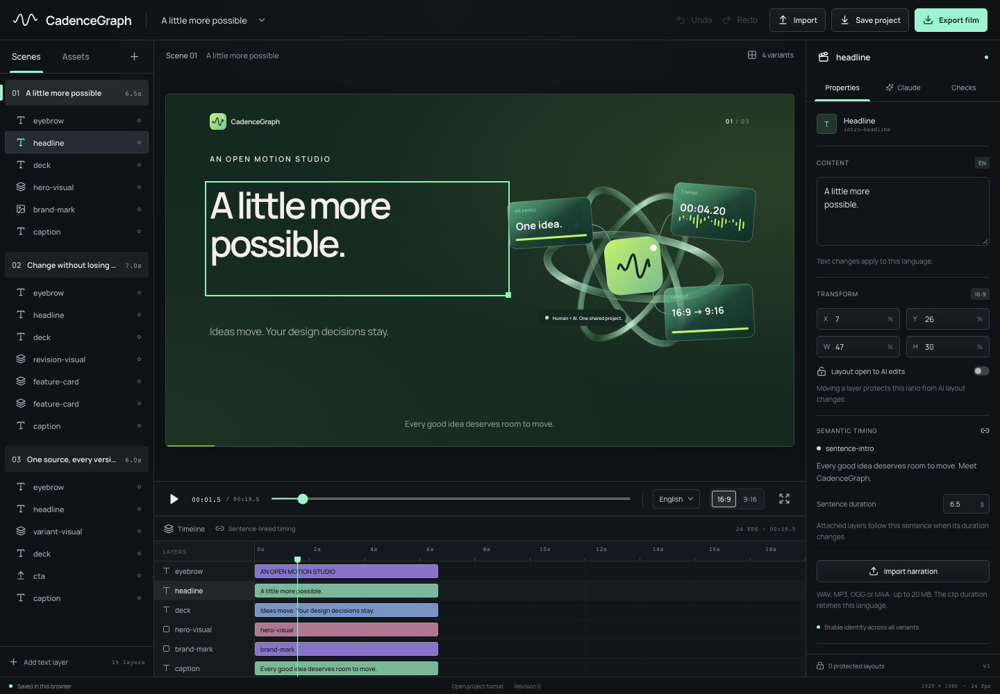

<div align="center">

# CadenceGraph

**Ideas move. Your design decisions stay.**

An open motion studio where people and Claude edit the same versioned project.

[Get started](#run-locally) · [Watch the films](#real-rendered-demos) · [Project format](docs/project-format.md) · [Build a component](docs/components.md) · [Contribute](CONTRIBUTING.md)

</div>



Change a sentence. Switch language. Move a card for portrait. Ask Claude for a revision. The timing follows the sentence; your protected layout stays where you put it. Every AI proposal is inspectable before it becomes an edit.

**Technical alpha — v0.1.0-alpha.3.** A working local editor and deterministic export pipeline for a deliberately bounded project format. This is not a replacement for every capability of a mature video editor.

## Run locally

Requirements: Node.js **22.12+** (22 or 24 LTS recommended), npm, and FFmpeg with `ffprobe` and `libx264` on PATH. macOS and Ubuntu are the verification targets. Chrome login is not required.

```sh
git clone https://github.com/webizmo/cadencegraph.git
cd cadencegraph
npm ci
npx playwright install chromium
# macOS, if FFmpeg is missing: brew install ffmpeg
# Ubuntu: sudo apt-get install ffmpeg
npm run dev
```

Open **http://127.0.0.1:5173**. The original three-scene example works without an AI account or network media. `npm run build && npm start` serves the production build locally. The server intentionally binds to loopback; it is not a multi-user service.

## Make a revision

1. Select **9:16**, choose a layer, and drag it or edit its X/Y fields. The ratio-specific position becomes protected.
2. Switch to **Türkçe**. Change the sentence duration, or choose an audio file in the inspector. Its measured duration updates that sentence and dependent events only in Turkish.
3. Open **Claude**, describe the change, and review each proposed operation and affected output. Apply it or dismiss it. Protected-layout and stale-revision conflicts block the whole transaction.
4. Use **Undo / Redo**, switch between four variants, and scrub the shared timeline. Save project JSON and reopen it later.
5. Open **Checks** and export a real H.264/AAC MP4. The renderer measures text boxes, canvas bounds, fonts and media in Chromium before encoding.

`Space` plays/pauses. `Cmd/Ctrl+Z` undoes; `Cmd/Ctrl+Shift+Z` redoes. Work is saved in browser local storage. Export project JSON for a durable copy. Uploaded media lives in `public/assets/uploads/`; copy those files alongside the project when moving machines. JSON export is not a media archive.

## Claude integration

Install [Claude Code](https://code.claude.com/docs/en/overview) and sign in using `claude auth login`. CadenceGraph invokes the installed CLI with your existing subscription or configured credentials. It does not bundle Claude Code, store keys in the project, or silently simulate Claude. Provider requests consume your account's allowance.

The local server sends the project JSON and your instruction to Claude. Tools, MCP servers, hooks and session persistence are disabled for this call; the model returns schema-constrained operations. Core validation is repeated before preview and application. Only clicking **Apply proposal** changes the editor project. No arbitrary model-generated code is executed.

The live-provider acceptance record is in [docs/verification/claude-live.json](docs/verification/claude-live.json). Most automated browser tests use explicitly labeled fixtures for reproducibility; they are distinct from this real call.

## Real rendered demos

The [alpha release](https://github.com/webizmo/cadencegraph/releases/tag/v0.1.0-alpha.3) includes four base MP4 files and four more after the five-revision scenario, plus posters and machine-readable render reports. They are generated from one source project, not screen recordings.

| Variant | Frame size | Frame rate | Source |
| --- | --- | --- | --- |
| English · landscape | 1280 × 720 | 24 fps | [demo.json](examples/demo.json) |
| English · portrait | 720 × 1280 | 24 fps | Same project |
| Türkçe · landscape | 1280 × 720 | 24 fps | Same project |
| Türkçe · portrait | 720 × 1280 | 24 fps | Same project |

```sh
npm run render -- --all
npm run render -- --locale tr --ratio 9:16
npm run render -- --project examples/demo.json --locale en --ratio 16:9 --width 1920
```

Videos and reports go to `outputs/` (Git-ignored). Default demo durations are 19.5 seconds in English and 22 seconds in Turkish. The included score is synthesized from original project code. **The base films have no spoken narration.** Importing your own sentence audio is supported; it is measured, placed on the sentence and mixed into the export. Captions are authored sentence-level text, not automatic transcription or word alignment. The revised Turkish films include a nine-second instrumental audio fixture that proves file retiming; it is not spoken Turkish. Video source audio is muted; attach narration as sentence audio. The synthesized score is added during export.

## What works

- Open, versioned JSON format; stable identities; locale-specific text and duration.
- Sentence-linked node start/end times and independent portrait layout overrides.
- Atomic human/AI transactions, protected layouts, visible conflicts, monotonic undo/redo.
- Text, image/video media, cards, captions, CTA and registered deterministic React components.
- Local visual editing, timeline, playback, four variants, JSON import/export and media import.
- Real Claude Code proposal generation and review, without an embedded secret.
- Shared React preview/export composition, frame-by-frame Chromium capture, FFmpeg encoding and per-output reports.

## Boundaries of this alpha

The editor starts with the included project; scene structure and custom components are authored in JSON/code. It is not an arbitrary HTML/React importer, a general keyframe editor, a collaboration server, an automatic translator, a speech generator, or a word-level caption aligner. Components are trusted developer code registered at build time; project JSON cannot introduce executable code. Remote media must be downloaded/imported before export. Font and text checks are mechanical, not a substitute for creative or accessibility review. Browser playback and export share visuals; exact audio-device latency and every GPU/browser combination are not certified. Rendering is local and sequential; no cloud farm, parallel queue or production multi-tenant isolation is claimed.

HyperFrames, Remotion and Diffusion Studio already offer substantial editing and rendering functionality. Our experiment is the explicit relationship between meaning, timing and protected human decisions. No comparative speed, adoption, or feature-parity claim is made.

## Development

```sh
npm run check       # core, API, motion tests; TypeScript; production build
npm run test:e2e    # editor acceptance in Chromium
npm audit
npx tsx scripts/verify-claude.ts  # optional real provider call, requires login
```

See [architecture](docs/architecture.md), [format](docs/project-format.md), [renderer](docs/rendering.md), [components](docs/components.md), [verification](docs/verification/README.md), [security](SECURITY.md) and [third-party licenses](THIRD_PARTY_NOTICES.md).

Apache-2.0 for original source and original demo graphics. Fonts and external tools retain their own licenses. Built by [Webizmo](https://webizmo.tr).
